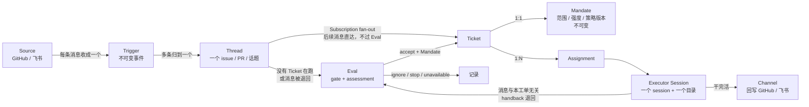

# DeepSeek 的 Super-agent 原型读解：一个面向 GitHub 仓库的自主编码 agent

2026 年 10 月底，DeepSeek Harness 团队开源了 dsh-superagent-prototype（[GitHub 仓库](https://github.com/DeepSeek-ai/dsh-superagent-prototype)），并配套发布了文章《Exploring Super-agent Design: Towards a More Autonomous Agent System》。这是一个针对单个 GitHub 仓库工作的 proactive coding agent：监听 GitHub（可选飞书），在有人请求或规则允许时自动开工，修 bug、提 PR、在原对话里回复结果。

README 写得很直白：这是研究原型，不是官方产品，大量工程由 coding agent 完成，风格可能不一致，发布前做了适配，内部版本和论文描述的实现不完全相同。论文里的部分设计是未来方向，这个原型没实现。

## 核心理念：注意力是最稀缺的资源

整个项目建立在一个判断上：**花尽可能少的人的注意力，换尽可能多的价值**。每条消息、每次提问、面板上的每个元素都占用某个人的注意力，必须产出超过成本的价值，否则删掉。

这直接决定了 agent 的行为边界：

- 只在被点名请求，或团队写下的规则允许时才行动
- 团队没要求的事，agent 可以主动发现，但先只记录「我本会做什么」，不真做
- 只在必须有人决策、或有人用得上结果时才说话，工作过程保持安静
- 一次只问一个具体问题，不发长报告
- 如实汇报：没做完就说没做完，失败就报失败

README 最后给运营者的提醒也值得记下：agent 以团队名义发消息、提 PR，运营者要为此负责。建议起步窄——短允许名单、主动工作只记录，确认合理再放宽；发现噪音就收紧 prompt 或暂停，而不是加消息去解释。

## 领域模型：八个概念撑起整条链路

项目的工作流可以画成这样：

各概念的职责：

| 概念 | 一句话 |
|------|--------|
| Source | 事件流，监听 GitHub 或飞书，维护读位置，重启不重放 |
| Trigger | 一条具体事件，不可变，是幂等和审计的单位 |
| Thread | 按时间排序的 Trigger 组，一个 issue / PR / 话题就是一个 Thread |
| Eval | 两层判断：确定性的 gate（谁有权限）+ 模型的 assessment（内容要不要接） |
| Mandate | accept 授予的凭证：范围、强度、当时的策略版本，不可变 |
| Ticket | 被授权的工作单元，有独立生命周期，不跟随 Executor 的状态 |
| Assignment | Ticket 和一个 Executor 的绑定，可以多次换人 |
| Subscription | Ticket 和 Thread 的多对多订阅，后续消息直接送达 |

对应关系：一个 Source 产生多条 Trigger；多条 Trigger 归到一个 Thread；一个 Thread 可以先后开多个 Ticket（或通过 Subscription 订阅多个 Thread）；一个 Ticket 同一时刻绑定一个 Executor。

## 三种消息路径

理解这个系统的关键是分清一条消息进来后走哪条路：

1. **走 Eval**：Thread 里没有 Ticket 在跑，或 Executor 判定消息和自己无关退回来。Eval 判断要不要开新工作。
2. **走 Subscription fan-out**：Ticket 正在跑，Thread 里来了新消息，直接送进 Executor，不过 Eval，不重新授权。这解决了「工作开始后的后续讨论怎么跟上」——同一个讨论串里补一句需求，Executor 直接收到。
3. **唤醒 ended 的 Ticket**：Ticket 结束后，Thread 里来了人的消息，Ticket 靠原来的 Mandate 自动恢复，不过 Eval。Executor 拿到消息后自己判断：相关就继续干，无关就 handback 退回，退回的消息重新进 Eval，可能开出新的 Ticket。

第二条和第三条路合并起来看是同一个设计选择：**投递和授权分开**。Subscription 只负责把消息送到，不管内容；Mandate 负责授权，不负责投递。判断「这条消息和手头的活有没有关系」交给 Executor，因为它有完整上下文。

## 明确拒绝的设计

001 文档列了 12 条被拒绝的方案，这些比采纳的方案更能说明取舍。挑几条核心的：

- **不建 Person/Membership 实体**：人只是 Trigger 的元数据，允许名单属于 Policy 按 Source 分开管。同一个人在 GitHub 和飞书的账号不做映射，靠 prompt 让 agent 自己理解。这避免了跨平台身份同步的复杂性。
- **不让 Eval 自己调度延迟事件**：「需要等一段时间」的条件做成一种 Source，Eval 不回头依赖 Source。
- **不限制一个 Thread 只有一个活 Ticket**：同一个讨论串可以并行多个独立工作。
- **Policy 改了不取消在跑的 Ticket**：取消会留下半成品，改成通知和记录，让当前工作收尾。
- **Executor 卡住不锁全部工具**：人可能还想直接在那个 session 里干活，暂停自动输入就够了。

12 条的共同逻辑是：每条拒绝都在避免用一个概念去干另一个概念的事。授权归 Mandate，投递归 Subscription，上下文归 Correlation，停止强度归 Eval，状态归 Ticket，职责互不越界。

## Eval 输出的四种 Decision

| Decision | 含义 | 后果 |
|----------|------|------|
| accept | 接活 | 创建 Ticket + Mandate，派给 Executor |
| stop | 停止 | 停掉正在跑的工单，撤销授权 |
| ignore | 忽略 | 不开新工作，Trigger 记录在案 |
| unavailable | 无法完成评估 | 超时或模型不可用，Trigger 重新排队，连续三次才记录为 unavailable，管理员可以在面板上重新评估 |

每个 Decision 都带 strength（explicit 是人直接点名，inferred 是规则推断）和 reason（如 `not_a_member`：不在允许名单）。在非 auto 模式下，推断出的 accept 只记录「本会 accept」，不真建工单。

## 哪些可复用，哪些自己写

没有现成的 SDK 可以直接装——这个项目是 DeepSeek Harness 的 bundle，绑定在 DeepSeek 自家的 agent runtime 上，依赖 `@deepseek-ai/*` 的私有包，离开这个生态跑不起来。

它的价值在于设计说明书本身：

- **可复用**：领域模型的概念和规则。换一个项目，照着 001 文档理解就能搬。
- **属于部署**：Source 怎么接平台（GitHub / 飞书，换 Slack 钉钉也行）、Policy 规则内容（每个团队自己定）、Executor 用什么 runtime、Channel 怎么回写。

008 文档甚至给了一个 cookbook，演示如何从零实现一个新 Source（翻译事件、定义授权规则、提供回写、维护轮询循环），说明团队确实把它当架构模板来写。

## 原型的实验数据

论文给的对比数字：Super-agent 架构下任务完成 p50/p95 = 12.4/15.7 分钟，单 session + subagent 的基线 p95 是 29.5 分钟。去掉 direct-pass 路由后，Router 决策增加约 30%，缓存读取 token 增加约 37%。这些是合成负载的实验结果，不是生产数据。

## 值得学的地方

抛开 DeepSeek 生态，这个项目有三点对任何做 agent 系统的人都有参考价值：

1. **「注意力成本」作为唯一的设计判据**。不是「能不能做到」，而是「值不值得占用人的注意力」。这个判据筛出了行为边界，也筛出了架构取舍。
2. **职责分离的干净程度**。授权、投递、上下文、状态、停止强度各归各的概念，不越界。12 条被拒绝的设计是最好的证据——每条都在防止一个概念干另一个概念的事。
3. **文档的写法**。按编号递进，每篇只依赖前面的概念；明确列出被拒绝的方案；区分可复用的模型和属于部署的实现。这种文档本身就值得借鉴。

原型状态：MIT 协议，TypeScript，需要 Node.js ≥22.19、GitHub CLI ≥2.48，单仓库部署。README 提醒它可能仍有 bug，工程风格不一致——当作设计参考来读，比当作工具来用更合适。
