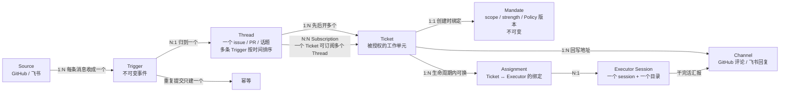

# dsh-superagent 学习笔记

学习对象：DeepSeek Harness 团队的 [dsh-superagent-prototype](https://github.com/DeepSeek-ai/dsh-superagent-prototype)。这是一个针对单个 GitHub 仓库的 proactive coding agent：监听 GitHub（可选飞书），在有人请求或规则允许时自动开工，修 bug、提 PR、在原对话里回复结果。研究原型，不是官方产品；大量工程由 coding agent 完成；内部版本和论文《Exploring Super-agent Design: Towards a More Autonomous Agent System》描述的实现不完全一致，论文里的部分设计是未来方向。

## 000 哲学

核心原则一句话：花尽可能少的人的注意力，换尽可能多的价值。每条消息、每次提问、面板上的每个元素都占用注意力，必须产出超过成本，否则删掉。

对 agent 行为的要求：

- 只在被点名请求，或团队写下的规则允许时才行动。团队没要求的事可以主动发现，但先只记录「我本会做什么」，不真做。
- 只在必须有人决策、或有人用得上结果时才说话，工作过程保持安静。
- 一次只问一个具体问题，不发长报告。
- 停止的标准是影响到位，不是力气花够。
- 如实汇报：没做完就说没做完，失败就报失败。

对设计的要求：概念少、配置少、面板只显示等人的事、文档按编号递进。

给运营者的责任：agent 以团队名义发消息、提 PR，运营者负责读和纠。起步窄——短允许名单、主动工作只记录，确认合理再放宽；发现噪音就收紧 prompt 或暂停，而不是加消息去解释；别用 agent 冲量。

和 personal agent 的区别：personal agent 优化一个人的效率，靠习惯猜需求；dsh-superagent 服务团队，授权靠明确的允许名单和规则，不靠猜，运营者对 agent 的发言负责。更接近「纪律严格的团队新成员」。

## 001 领域模型

### 工作流程

```
Source 产生 Trigger
    ↓
Trigger 归到 Thread
    ↓
两条路：
  1. 订阅了该 Thread 的 Ticket 直接收到（不过 Eval）
  2. 没有 Ticket 接住 → 进 Eval 判断
    ↓
Eval accept → 创建 Ticket + Mandate
    ↓
Assignment 派给 Executor
    ↓
结果通过 Channel 回写 Source
```

mermaid 完整版：



### 概念与规则

| 概念 | 是什么 | 关键规则 |
|------|--------|----------|
| Source | 事件流（GitHub 通知、飞书消息等） | 自己维护读位置，重启不重放；过滤 bot 自己的消息 |
| Trigger | 不可变的事件 | 幂等单位：同一条 Trigger 重复提交只创建一个 Ticket |
| Thread | 按时间排序的一组 Trigger | 同一时刻最多一个 Eval 在跑；可以有多个 Ticket |
| Eval | 两层判断：gate + assessment | 无状态；判断依据当前的 Policy 版本 |
| Mandate | accept 授予的授权凭证 | 记录 scope、强度、Policy 版本；不可变。只有人叫停或 Policy 不再支持才失效 |
| Ticket | 被授权的工作单元 | 只有 Eval 能创建。有自己的生命周期，不跟随 Executor 的状态 |
| Assignment | Ticket 和 Executor 的绑定 | Ticket 可以多次换 Executor；每次绑定独立记录 |
| Subscription | Ticket 和 Thread 的多对多订阅 | 后续消息直接 fan-out 给订阅的 Ticket，不过 Eval |
| Channel | Thread 的写回通道 | 一个 Ticket 可以往多个 Channel 写 |
| Policy | 版本化的评估规则，含每个 Source 的允许名单 | 改了 Policy 不撤销已发出的 Mandate，但通知在跑的 Ticket |

数量关系：

| 关系 | 说明 |
|------|------|
| Source : Trigger = 1 : N | 一个 Source 产生多条 Trigger；每条 Trigger 只属于一个 Source |
| Source : Thread = 1 : N | 一个 Source 管多个 Thread |
| Trigger : Thread = N : 1 | 多条 Trigger 归到一个 Thread；一条 Trigger 只归一个 Thread |
| Thread : Ticket = 1 : N | 一个 Thread 可以先后开多个 Ticket |
| Thread : Ticket = N : N | 通过 Subscription，一个 Ticket 可以订阅多个 Thread |
| Thread : Eval = 1 : 1（同时） | 同一时刻最多一个 Eval；先后可以多个（串行） |
| Ticket : Mandate = 1 : 1 | 创建时确定，不可变 |
| Ticket : Assignment = 1 : N | 生命周期内可以换 Executor |
| Ticket : Channel = 1 : N | 可以往多个地址回消息 |
| Executor : Session = 1 : 1 | 一个 Executor 就是一个 agent session + 一个工作目录 |

### 场景例子

场景 1：张三在 issue #42 里 @agent 修 bug。Trigger T1 → Thread（issue #42）→ Eval（张三在允许名单 ✓，明确请求 ✓）→ accept → Ticket #1 + Mandate → Assignment → Executor Session A → 修 bug 提 PR → Channel 在 issue #42 回评论。

场景 2：李四在同一 issue 补充「顺便把日志也加上」。Trigger T2 → Thread → Ticket #1 已订阅 → Subscription fan-out 直达，不过 Eval → Executor 继续修。李四没有再 @agent。

场景 3：PR 合并，Thread 关闭，Ticket #1 ended。三周后张三说「修法有问题，回归了」。Trigger T3 → Thread → Ticket #1 自动恢复（Subscription 还在，Mandate 有效）→ 新 Assignment → 新 session，同一个 Ticket 继续跑。

场景 4：王五在同一 issue 提出「文档也该更新了」。T4 → Ticket #1 自动恢复（机械动作，不看内容）→ Executor 判断：和修 bug 无关 → handback 退回，附理由 → T4 重新进 Eval → accept 开 Ticket #2。Ticket #1 再次结束，保留 Subscription。

关键设计：恢复是机械动作，判断在 Executor 手里。Subscription 只管投递，保证后续消息一定到达；判断「这条消息和手头的活有没有关系」交给 Executor，因为它有完整上下文。代价是不相关的消息让旧 Ticket 白醒一次，换来相关消息不用重新过 Eval。

### Eval 的四种 Decision

| Decision | 含义 | 后果 |
|----------|------|------|
| accept | 接活 | 创建 Ticket + Mandate，派给 Executor |
| stop | 停止 | 停掉正在跑的 Ticket，撤销授权 |
| ignore | 忽略 | 不开新工作，Trigger 记录在案 |
| unavailable | 无法完成评估 | 超时或模型不可用，Trigger 重新排队，连续三次才记录 |

每个 Decision 带 strength（explicit：人直接点名；inferred：规则推断）和 reason（如 `not_a_member`）。非 auto 模式下，推断出的 accept 只记录「本会 accept」，不真建工单。stop 和 unavailable 不算「解决了问题」（代码里 `settled` 判断排除了它们）；被 stop 的 Trigger 还会重新排队。

### 被拒绝的设计（12 条）

| 被拒绝的方案 | 理由 |
|---|---|
| 建 Person/Membership 实体，或跨 Source 身份映射 | 人只是 Trigger 的元数据；允许名单属于 Policy 按 Source 分开管；跨平台映射靠 prompt 文本 |
| 让 Eval 自己调度延迟的 Trigger | 「需要等一段时间」的条件做成一种 Source，Eval 不回头依赖 Source |
| 给 Eval 加 waiting 或 revoked 状态 | 等待属于 Source；Eval 超时就把 Trigger 重新排队，或记录 `unavailable` |
| 限制一个 Thread 只能有一个活 Ticket | 一个 Thread 可以并行多个独立工作；去重靠 assessment 自己看 Ticket 列表 |
| 做「追加到 Ticket」的 Decision | 追加就是 Subscription fan-out，不需要新的决策类型 |
| 给 Subscription 做过路检查 | Subscription 覆盖整个 Thread，只管投递；授权由 Mandate 负责 |
| 让 Correlation 参与路由 | Correlation 只加上下文；路由是 Subscription 的事 |
| 让 Ticket 状态跟随 DSH Session | Ticket 可以换 Executor、恢复运行、被多个 Executor 跑过，状态必须自己定义 |
| 让 Executor 自己宣布「人叫我停了」 | 停止的强度只有 Eval 能决定 |
| Policy 改了就取消在跑的 Ticket | 取消会留下半成品；改成通知和记录，让当前工作收尾 |
| Executor 卡住就锁掉全部工具 | 人可能还想直接在那个 session 里干活；暂停自动输入就够了 |
| 从报告的自由文本里猜「在等人」 | 「等人」必须用结构化字段报告 |

共同逻辑：每条拒绝都在避免用一个概念去干另一个概念的事。授权归 Mandate，投递归 Subscription，上下文归 Correlation，停止强度归 Eval，状态归 Ticket，职责互不越界。

### 可复用与部署的边界

| 部分 | 在这个仓库里的实现 | 换部署时 |
|------|-------------------|---------|
| 领域模型 | 概念本身和规则 | 可复用，换项目不用重写 |
| Source | GitHub 通知、issue/PR/CI；飞书直播事件、话题轮询 | 属于部署，换平台就换 |
| Policy | 评估规则、允许名单、bot 列表、过路表 | 属于部署，每个团队自己定 |
| Executor | DSH Executor Session + 每 Ticket 一个目录 | 属于部署，换 agent runtime 就换 |
| Channel | 飞书话题回复、GitHub 评论和 review 回复 | 属于部署，换平台就换 |

没有现成的 SDK——项目是 DeepSeek Harness 的 bundle，依赖 `@deepseek-ai/*` 私有包，离开这个生态跑不起来。它的价值在于设计说明书本身。008 文档给了一个 cookbook，演示从零实现新 Source 的四步：翻译事件、定义授权规则、提供回写、维护轮询循环。

### 术语表（中英对照）

| 英文 | 中文 | 含义 |
|------|------|------|
| Agent | 智能体 | dsh-superagent 跑的自动化成员 |
| Main Session | 主 Session | 评估 Trigger、接单派单的 session，代码里叫 `orchestrator` |
| Executor Session | 执行器 Session | 一个 Ticket 对应的干活的 session，代码里叫 `worker` |
| Source | 来源 | 事件流：一种插件提供的能力 + 一个实例配置 |
| Trigger | 触发 | Source 的一条不可变事件 |
| Thread | 线程 | 按时间排的 Trigger 序列，Eval 的观察窗口 |
| Correlation | 关联 | 共享 Trigger 的 Thread 之间的关系，只加上下文 |
| Channel | 通道 | Thread 的写回侧 |
| Policy | 策略 | 版本化的接活规则，含每个 Source 的允许名单 |
| Policy version | 策略版本 | 规则 + Source 部件 + accept 模式的一个组合标识 |
| Eval | 评估 | 把一批 Trigger 变成 Decision 的过程 |
| Gate | 准入 | Eval 第一层：谁能发起工作、以什么强度 |
| Assessment | 研判 | Eval 第二层：模型的判断 |
| Decision | 决定 | Eval 的结果 |
| Mandate | 授权 | accept 授予的凭证：强度、范围、Policy 版本 |
| Ticket | 工单 | 被授权的工作单元 |
| Assignment | 派工 | Ticket 和一个 Executor 实例的绑定 |
| Subscription | 订阅 | Ticket 和 Thread 的关系 |
| Fan-out | 扇出 | 把订阅 Thread 的 Trigger 送到 Ticket 作为上下文 |
| Executor | 执行器 | 跑 Assignment 的端口：一个 session + 一个目录 |
| Execution environment | 执行环境 | Executor Session 和 prepare 命令运行的地方 |
| Report | 报告 | Assignment 向 Ticket 汇报的状态 |
| Attention | 待人工决定 | Ticket 上等人的问题 |
| Disposition | 去向 | 一条 Trigger 被过滤/评估/扇出后去了哪的记录 |
| Input | 输入 | 送到 Ticket 的上下文 |
| Scope | 范围 | Mandate 允许的工作范围 |
| Strength | 强度 | Mandate 或 Eval 的依据强度 |

## 002 授权（未完待续）

两条路径：Eval 决定是否开新工作（gate 检查发送者和 Policy），Subscription 延续已有工作（绕过 gate，不授予新权限，Ticket 仍受 Mandate 限制）。强度的三种取值：explicit（允许名单里的人点名，或有 Ticket 的 Thread 上的跟进）、inferred（不在名单的人在有 Ticket 的 Thread 上跟进，或 bot 列表里的 bot 消息）、not admitted（其他 bot 消息、被过路表忽略的、accept 模式为 off 时的一切推断）。
